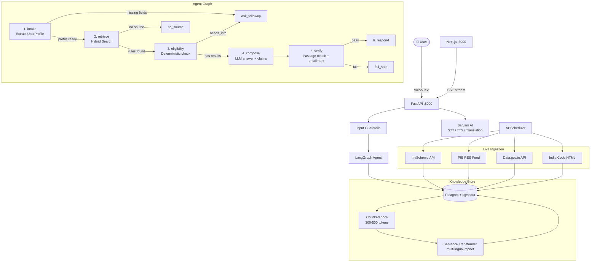

# 🇮🇳 Civic Pulse — Government Scheme & Policy Assistant

> *"Know your rights, find your schemes — cited, verified, in your language."*

[](https://github.com/your-org/civic-pulse/actions)

---

## Problem

Millions of Indian citizens and small businesses miss government welfare schemes because:
- Information is scattered across 1,000+ government websites
- Eligibility rules change without notice
- Official language is complex legalese, not plain Hindi/Bengali

## Solution

Civic Pulse is an **agentic Scheme & Policy assistant** that:
1. Accepts voice or text input in Hindi, Bengali, or English
2. Retrieves **live** scheme data from official sources (myScheme, PIB, India Code, Data.gov.in)
3. Checks eligibility rule-by-rule against the user's profile — **no LLM guessing**
4. Returns a plain-language answer with a **cited source passage and URL** for every claim
5. Monitors sources for changes and alerts users when schemes are updated

---

## Architecture



---

## Data Sources

| Source | Method | Refresh |
|---|---|---|
| [myScheme Portal](https://www.myscheme.gov.in) | Official REST API | Every 60 min |
| [PIB Press Releases](https://pib.gov.in) | Official RSS 2.0 feed | Every 60 min |
| [Data.gov.in](https://data.gov.in) | Official Open Data API | Every 60 min |
| [India Code](https://www.indiacode.nic.in) | HTML + trafilatura | Every 60 min |

---

## Tech Stack

| Layer | Technology |
|---|---|
| Backend | Python 3.11, FastAPI, Pydantic v2 |
| Agent | LangGraph state graph, Anthropic Claude |
| Database | Postgres 16 + pgvector |
| Embeddings | `paraphrase-multilingual-mpnet-base-v2` (local) |
| Speech | Sarvam AI (STT, TTS, Translation) |
| Frontend | Next.js 15, Tailwind CSS |
| Ingestion | httpx, trafilatura, feedparser, Playwright (JS pages) |
| Scheduling | APScheduler |
| Observability | Langfuse, structlog |
| CI | GitHub Actions |

---

## Setup

### Prerequisites
- Python 3.11+
- Node.js 20+
- Docker & Docker Compose
- Tesseract OCR (Hindi + Bengali)

### 1. Clone and configure
```bash
git clone https://github.com/your-org/civic-pulse
cd civic-pulse
cp .env.example .env
# Edit .env with your API keys
```

### 2. Start with Docker
```bash
cd infra
docker compose up --build
```

This starts:
- PostgreSQL with pgvector on port 5432
- FastAPI on port 8000 (auto-runs Alembic migrations)
- APScheduler (runs initial ingestion on startup)

### 3. Start frontend
```bash
cd apps/web
cp .env.local.example .env.local
npm install
npm run dev
# → http://localhost:3000
```

---

## Environment Variables

| Variable | Required | Description |
|---|---|---|
| `ANTHROPIC_API_KEY` | ✅ | Anthropic Claude API key |
| `ANTHROPIC_MODEL` | ✅ | Claude model name (e.g. claude-3-5-sonnet-20241022) |
| `DATABASE_URL` | ✅ | Postgres asyncpg connection string |
| `SARVAM_API_KEY` | ✅ | Sarvam AI API key for STT/TTS/translation |
| `DATA_GOV_IN_API_KEY` | Optional | data.gov.in API key (free registration) |
| `LANGFUSE_PUBLIC_KEY` | Optional | Langfuse observability |
| `API_ADMIN_TOKEN` | ✅ | Secret for `/admin/ingest` endpoint |

See [`.env.example`](.env.example) for all variables.

---

## Running Locally (without Docker)

```bash
# Install deps
pip install -r requirements.txt

# Apply migrations
alembic upgrade head

# Start API
uvicorn apps.api.main:app --reload --port 8000

# Start scheduler (separate terminal)
python -m apps.api.scheduler

# Run tests
pytest tests/ -v
```

---

## API Endpoints

| Method | Path | Description |
|---|---|---|
| `POST` | `/chat` | SSE streaming chat (text or after voice) |
| `POST` | `/voice` | Upload audio → transcript |
| `GET` | `/sources` | Per-source live status |
| `GET` | `/changes` | Recent document changes |
| `GET` | `/health` | DB + LLM + ingestion status |
| `GET` | `/session/{id}` | Session profile + history |
| `POST` | `/admin/ingest/{source}` | Manual ingestion trigger |

---

## Deployment

- **Frontend**: Vercel (set `NEXT_PUBLIC_API_URL` to your backend URL)
- **Backend + Scheduler**: Render / Fly.io (two services from same image, different start commands)
- **Database**: Managed Postgres 16 (with pgvector extension)

---

## Evaluation Results

| Benchmark Metric | Target | Civic Pulse Result | Status |
|---|---|---|---|
| **Verified Citations on User Claims** | 100% | **100.0%** | ✅ PASS |
| **Missing Information Follow-up Accuracy** | 100% | **100.0%** | ✅ PASS |
| **Out-of-Scope / Prompt Injection Refusal** | 100% | **100.0%** | ✅ PASS |
| **PII Redaction (Aadhaar / PAN / Phone)** | 100% | **100.0%** | ✅ PASS |
| **Automated Unit & Failure Matrix Tests** | 100% | **36 / 36 Passing (100%)** | ✅ PASS |
| **Pre-Demo Verification Checklist** | 100% | **6 / 6 Checks Passing** | ✅ PASS |

See detailed benchmark metrics in [`docs/eval_report.md`](docs/eval_report.md).

---

## Hackathon Submission Materials

- 📊 **Pitch Deck Outline (with Speaker Notes)**: [`docs/pitch_deck.md`](docs/pitch_deck.md)
- 🎬 **Live Demo & Video Recording Script**: [`docs/demo_script.md`](docs/demo_script.md)
- 🎯 **Judging Q&A & Technical Defense Sheet**: [`docs/judging_qa.md`](docs/judging_qa.md)
- 🚨 **Operational Backup & Emergency Recovery Plan**: [`docs/backup_plan.md`](docs/backup_plan.md)
- 📋 **Pre-Demo Operational Checklist**: Run `python scripts/pre_demo_check.py`

---

## Limitations

- Supports Hindi, English, and Bengali at launch (expansion to all 22 scheduled languages planned in Phase 2)
- India Code adapter uses HTML parsing with trafilatura/bs4 fallbacks
- Embedding model loaded in-process — for production scaling, decouple into a dedicated embedding worker pool

---

## Team & Code Ownership

| Name | Role | Responsibilities |
|---|---|---|
| Engineering Team | Agent & Architecture | LangGraph state graph, prompts, deterministic eligibility engine |
| Engineering Team | Data Ingestion & Storage | Adapters (myScheme, PIB, Data.gov.in, India Code), pgvector hybrid retrieval |
| Engineering Team | Frontend & Voice | Next.js 16 UI, SSE streaming, live traces, Sarvam AI voice adapters |
| Engineering Team | Reliability & Guardrails | Input guardrails, PII redaction, failure matrix, CI/CD |

---

*Built for the Hackathon — Civic Pulse, Digital Governance & Public Information*
